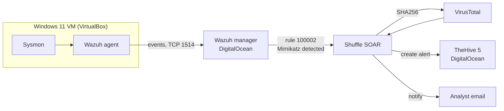

# Cloud SOC Automation Lab


A cloud-hosted Security Operations Center pipeline that detects credential-dumping activity on a Windows endpoint and
automatically enriches it, opens a case, and notifies an analyst, with no manual steps between the alert and the ticket.

## What it does

A Windows 11 VM runs Sysmon and the Wazuh agent. When Mimikatz executes, a custom Wazuh rule raises a level 15 alert.
That alert is pushed to a Shuffle workflow, which extracts the file's SHA256, checks it against VirusTotal, creates an
alert in TheHive, and emails the analyst.



## Components

| Role | Technology | Hosted on |
| :--- | :--- | :--- |
| SIEM / XDR | Wazuh 4.14 (all-in-one: manager, indexer, dashboard) | DigitalOcean, Ubuntu 24.04, 8 GB RAM |
| Case management | TheHive 5.5.3 (with Cassandra 4.1 and Elasticsearch 7.17) | DigitalOcean, Ubuntu 24.04, 8 GB RAM |
| Endpoint | Windows 11, Sysmon + sysmon-modular config, Wazuh agent | VirtualBox |
| SOAR | Shuffle (cloud) | shuffler.io |
| Enrichment | VirusTotal API | n/a |

## Detection

| Rule ID | Level | Logic | MITRE ATT&CK |
| :-: | :-: | :--- | :--- |
| `100002` | 15 | Sysmon Event ID 1 where `originalFileName` matches `mimikatz.exe` (survives renaming) | [T1003, OS Credential Dumping](https://attack.mitre.org/techniques/T1003/) |

Rule source: [`detections/local_rules.xml`](detections/local_rules.xml). The test plan, including the false-positive
and blind-spot checks, is in [`docs/05`](docs/05-custom-detection-rules.md).

<!--
RESULTS: uncomment this section after adding the screenshots listed in evidence/README.md

## Results

| Stage | Proof |
| :--- | :--- |
| Level 15 alert in Wazuh |  |
| Shuffle workflow |  |
| Case created in TheHive |  |
-->

## Build it yourself

Follow the guides in order:

1. [Cloud infrastructure and firewalls](docs/01-cloud-infrastructure.md)
2. [Wazuh server](docs/02-wazuh-server.md)
3. [TheHive server](docs/03-thehive-server.md)
4. [Windows 11 endpoint, Sysmon and Wazuh agent](docs/04-windows-endpoint.md)
5. [Telemetry review and custom detection rule](docs/05-custom-detection-rules.md)
6. [Shuffle SOAR workflow](docs/06-shuffle-soar-workflow.md)
7. [Lessons learned and roadmap](docs/07-lessons-and-roadmap.md)

Estimated cost: two 8 GB droplets running for a weekend. Destroy them when you are done.

## Repository layout

```
docs/          step-by-step build guides
detections/    Wazuh rule and integration snippets, ready to copy
evidence/      screenshots and exported workflow (see evidence/README.md)
```

## Safety and ethics

This lab runs credential-theft tooling and deliberately weakens Windows Defender on a **disposable VM**. Use it only on
systems you own, never reuse real passwords, and never commit IP addresses, API keys, or webhook URIs. See the safety
notes in [`docs/04`](docs/04-windows-endpoint.md).

## Limitations and roadmap

One signature-based detection and no automated response yet. The full list of known limitations and planned
improvements is in [`docs/07`](docs/07-lessons-and-roadmap.md).

## Credits

Built following the MyDFIR SOC Analyst project series. Version-specific fixes (TheHive 5.5 install, Cassandra 4.1,
Wazuh 4.14, the Cassandra cluster-name and memory-limit issues) and the validation plan are my own additions.

## License

[MIT](LICENSE)
