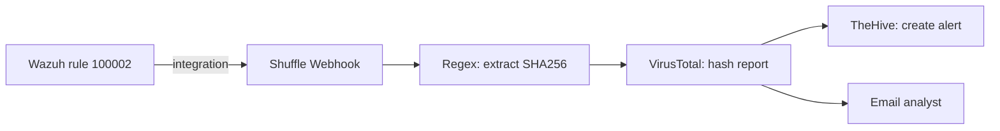

[Back to README](../README.md)

# 06. Shuffle SOAR Workflow

This guide connects everything: Wazuh alert → Shuffle webhook → hash extraction → VirusTotal → TheHive alert → email.



## Phase 1: Create the workflow

1. Sign in at [shuffler.io](https://shuffler.io/) and open **Workflows > Create Workflow** (name it, start from scratch).
2. Drag a **Webhook** trigger onto the canvas and copy its **Webhook URI**. Wazuh needs it in the next phase.

## Phase 2: Send Wazuh alerts to Shuffle

Wazuh ships a built-in `shuffle` integration, so no custom script is needed.

1. SSH into the Wazuh server and edit the manager config:
   ```bash
   sudo nano /var/ossec/etc/ossec.conf
   ```
2. Add this block inside `<ossec_config>` (a copy lives in
   [`detections/ossec_integration_shuffle.xml`](../detections/ossec_integration_shuffle.xml)):
   ```xml
   <integration>
     <name>shuffle</name>
     <hook_url>YOUR_SHUFFLE_WEBHOOK_URI</hook_url>
     <rule_id>100002</rule_id>
     <alert_format>json</alert_format>
   </integration>
   ```
   - `rule_id` limits forwarding to the Mimikatz rule from [05](05-custom-detection-rules.md). Without a filter
     Wazuh would forward every alert and burn through your VirusTotal quota.
   - Treat the webhook URI as a secret: anyone who has it can trigger your workflow. Do not commit it.
3. Restart and check the integration log for errors:
   ```bash
   sudo systemctl restart wazuh-manager
   sudo tail -f /var/ossec/logs/integrations.log
   ```
4. In Shuffle, press **Start** on the webhook so it is listening.

> [!NOTE]
> A **custom** integration (a script you write yourself) must be named with the prefix `custom-` (for example
> `custom-shuffle`), live in `/var/ossec/integrations/`, and be owned by `root:wazuh` with mode `750`. You only need
> that if you want to reshape the payload. The built-in `shuffle` integration does not need it.

## Phase 3: Make TheHive reachable from Shuffle

Shuffle's cloud runners connect to TheHive **from the internet**, but [01](01-cloud-infrastructure.md) locks port 9000
to your home IP. Pick one approach before building the TheHive step:

| Option | How | Trade-off |
| :--- | :--- | :--- |
| **A. Temporarily widen port 9000** (simplest for a short-lived lab) | Open 9000 on the TheHive firewall for the test, rely on API-key authentication, change the default `admin@thehive.local` password, and destroy or re-lock the droplet afterwards | Exposes the login page to the internet while open |
| **B. Self-host Shuffle** | Run Shuffle on a third droplet or on the TheHive droplet, and let it talk to TheHive over a private (VPC) address | More setup, but nothing needs to be exposed |
| **C. Reverse proxy with TLS** | Put TheHive behind Nginx/Caddy with HTTPS and an allow-list or auth layer | Best hygiene, most work |

Whichever you choose, the URL you enter in Shuffle is TheHive's **public (or VPC) address**, for example
`http://<THEHIVE_PUBLIC_IP>:9000`. A private home address such as `192.168.x.x` cannot work from Shuffle's cloud.

## Phase 4: Trigger an alert and extract the SHA256

1. On the Windows endpoint run Mimikatz (see [04](04-windows-endpoint.md)).
2. In Shuffle click **Explore Runs**. You should see the Wazuh alert JSON as the run's execution argument.
3. Drag in the **Shuffle Tools** app, connect it to the webhook, and rename it `SHA256 Regex`.
4. Set the action to **Regex capture group** with the pattern:
   ```
   SHA256=([0-9a-fA-F]{64})
   ```
5. For **Input data** click **+ > Runtime argument** and choose the Sysmon `hashes` field from the alert.
6. **Common mistake:** when passing the result to the next node, select only the matched `list` value under `group`.
   Selecting the whole object also sends status text such as `success` or `found`, and VirusTotal then rejects the hash.

## Phase 5: Enrich with VirusTotal

1. Create a [virustotal.com](https://www.virustotal.com) account and copy your API key from your profile.
2. In Shuffle add the **VirusTotal** app, authenticate once with the key (name it `VT Auto`), and choose the action
   **Get a hash report**.
3. Set the `hash` input to the regex node's output.
4. Re-run Mimikatz and confirm the VirusTotal node returns **status 200**.

> [!WARNING]
> The key goes into Shuffle's authentication store only. Never paste it into a doc, screenshot or commit. The free
> VirusTotal tier is limited to a few requests per minute, which is another reason to filter on a single rule ID.

## Phase 6: Create the TheHive alert

**In TheHive**
1. Create an **Organisation** (for example `SOC-Automation-Lab`).
2. Add two users: a normal analyst account for you, and a **service account** for Shuffle
   (use throwaway addresses such as `analyst@lab.example` and `shuffle@lab.example`).
3. Open the service account, click the eye icon and **Create API key**. Copy it into Shuffle only.

**In Shuffle**
1. Add the **TheHive** app below VirusTotal and authenticate with the service account's API key and the URL from
   Phase 3.
2. Set the action to **Create alert** and fill the fields using the Advanced editor (delete the default quotes
   around each field, and use **+ > Runtime argument** to pull values from the Wazuh alert):

| Field | Value |
| :--- | :--- |
| Title | `title` from the Wazuh alert |
| Flag | `false` |
| PAP | `2` |
| TLP | `2` |
| Severity | Wazuh's mapped severity, or `2` |
| Source | `Wazuh Alert` |
| Source ref | `rule_id` |
| Status | `New` |
| Summary | `Mimikatz activity detected on host ` + the `computer_name` runtime argument |
| Tags | `["T1003"]` |
| Type | `Internal` |

3. Save and re-run Mimikatz. The TheHive node should return **201 (Created)**, and the alert appears in the analyst's
   TheHive inbox.

## Phase 7: Email the analyst

1. Add the **Email** app, branching from VirusTotal (or TheHive).
2. Choose **Send Email (Shuffle)**. If it fails, configure a custom SMTP provider instead.
3. Set the recipient, a subject such as `Mimikatz detected`, and a body like
   `Malicious activity was detected and a ticket was created in TheHive.`
4. Run a final end-to-end test.

## Verification checklist

| Stage | Success signal |
| :--- | :--- |
| Wazuh rule | Level 15 alert "Mimikatz Usage Detected" in the dashboard |
| Integration | A new run appears in Shuffle's **Explore Runs**, no errors in `integrations.log` |
| Regex | A 64-character hash is output |
| VirusTotal | HTTP 200 and a report for the hash |
| TheHive | HTTP 201 and a new alert in the analyst inbox |
| Email | Message arrives with the expected subject |

## What this workflow does *not* do yet

An automated **response** (for example isolating the host with Wazuh active response after analyst approval) is not
built. It is on the roadmap in [07](07-lessons-and-roadmap.md).
